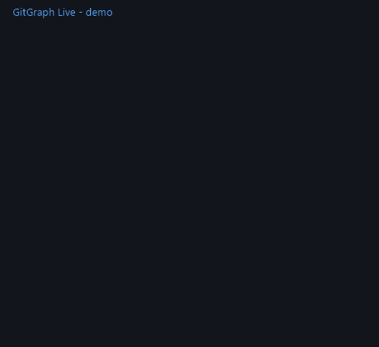

<div align="center">


# GitGraph Live

**Live commit graph + stale branch radar for GitHub** · Русский ниже

[](https://github.com/internetgodf/GitGraphLive/releases/latest)
[](LICENSE)
[](https://github.com/internetgodf/GitGraphLive)

[⬇️ **Download v0.4.0 (ZIP)**](https://github.com/internetgodf/GitGraphLive/releases/latest)



</div>

---

## What it adds to GitHub

**🗂 Graph tab** — a colorful commit graph for the last 40 commits of any repository:
each branch gets its own colored line, merges curve into the trunk, the trunk is always on the left
(like `git log --graph`). Hover any dot for *«author · message»*.

**🪦 Branches tab** — every branch ranked by last activity:
✅ alive · ⏳ no commits for 14+ days · 🪦 abandoned for 30+ days. Click a branch to open it on GitHub.

## Install (ZIP)

1. Download the ZIP from [Releases](https://github.com/internetgodf/GitGraphLive/releases/latest)
2. Unzip it into a folder
3. Open `chrome://extensions` (Brave: `brave://extensions`, Edge: `edge://extensions`)
4. Enable **Developer mode** (top right)
5. **Load unpacked** → select the unzipped folder
6. Open any GitHub repository → click the floating **⎇** button (bottom right)

Optional: click 🔑 in the panel and paste a [GitHub token](https://github.com/settings/tokens)
(no scopes needed) to raise the API limit from 60 to 5,000 calls/hour.

## Why it is privacy-friendly

- Reads **public GitHub API** only — no analytics, no tracking, no servers of its own
- The optional token stays in your browser's local storage and is sent only to `api.github.com`
- 10-minute cache: repeated page opens cost **zero** API calls

---

## Русская версия

**GitGraph Live** добавляет на GitHub две вещи, которых там не хватает.

- **🗂 Вкладка «Граф»** — живой граф последних 40 коммитов: у каждой ветки своя цветная линия,
  merge красиво вплетается в ствол, ствол всегда слева. Наведение на точку — «автор · сообщение»
- **🪦 Вкладка «Ветки»** — рейтинг брошенности всех веток репозитория:
  ✅ живая · ⏳ без коммитов 14+ дней · 🪦 брошена 30+ дней. Клик открывает ветку на GitHub

**Установка** — см. английский блок выше (это 6 шагов через режим разработчика).
**Токен** (необязателен): 🔑 в панели → вставить ключ (без разрешений) → лимит 5000 запросов/час.

## Roadmap

- [x] ▶ «Play the history» — timelapse animation of the graph growing (v0.4)
- [ ] «N commits behind main» badges for branches (compare API)
- [ ] Search & filters for the branches list
- [ ] Auto light theme
- [ ] Chrome Web Store publication

## Development

```bash
# no build step — plain JS, edit and reload:
# 1. extensions page → ⟳ on the GitGraph Live card
# 2. refresh the GitHub tab
```

Thresholds live at the top of `content.js` (`STALE_DAYS = 30`, `WORN_DAYS = 14`).

## License

[MIT](LICENSE) — use it, fork it, ship it.
